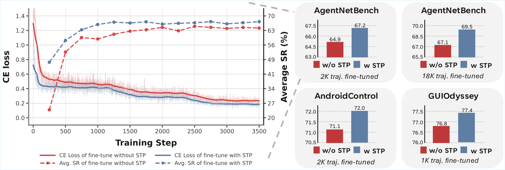

# Scaling GUI Agents with Visual State Transitions

Official code for the paper **"Scaling GUI Agents with Visual State Transitions"** ([arXiv](https://arxiv.org/abs/2607.24112)).

<p align="center">
  
</p>

## Overview

We introduce **State Transition Pretraining (STP)**, a two-stage training recipe for GUI agents that turns step-level visual state transitions `(s_t, a_t, s_{t+1})` into a scalable and complementary training signal for trajectory fine-tuning.

Before training on full task trajectories, STP pretrains the model on step-level transitions with two joint objectives:

- **Inverse Dynamics** — given two consecutive screenshots `(s_t, s_{t+1})`, predict the action `a_t`
- **Forward Dynamics** — given a screenshot and an action `(s_t, a_t)`, predict the next screenshot `s_{t+1}`

Transition data is orders of magnitude cheaper to collect than fully annotated task trajectories, and joint inverse + forward pretraining provides a stronger initialization than trajectory fine-tuning alone across desktop and mobile GUI benchmarks.

## Setup

### Requirements

```bash
pip install -r requirements.txt

# flash-attn needs --no-build-isolation:
pip install flash-attn==2.5.8 --no-build-isolation
```

### Model

We use [BAGEL-7B-MoT](https://github.com/ByteDance-Seed/Bagel) as the unified multimodal backbone. Download the checkpoint following the BAGEL repository instructions and point `MODEL_PATH` at it (default `./checkpoints/BAGEL-7B-MoT`).

### Data

See [data_preparation/README.md](data_preparation/README.md) for full download + conversion instructions. The short version:

```bash
export DATA_ROOT=/path/to/datasets    # or leave unset; default is ./datasets

# Download raw data
bash data_preparation/download_agentnet.sh
bash data_preparation/download_android_control.sh
bash data_preparation/download_guiodyssey.sh
bash data_preparation/download_agentnetbench.sh    # eval only

# Convert to training format
bash data_preparation/convert_agentnet.sh winmac
bash data_preparation/convert_agentnet.sh ubuntu
bash data_preparation/convert_android_control.sh
bash data_preparation/convert_guiodyssey.sh

# Subsample trajectories for the *_2k / *_3k / *_1k fine-tuning configs.
# (Skip if you will only fine-tune with the full-size configs
#  ft_agentnet_winmac or ft_agentnet_ubuntu.)
python data_preparation/subsample_agent_tasks.py \
  --input  ${DATA_ROOT:-./datasets}/agentnet/bagel_format/vlm_data/agent_tasks__winmac__l1.jsonl \
  --output ${DATA_ROOT:-./datasets}/agentnet/bagel_format/vlm_data/agent_tasks__winmac__l1__2k.jsonl \
  --num-trajectories 2000 --seed 42
# See data_preparation/README.md for the _3k (AndroidControl) and _1k (GUIOdyssey) commands.
```

## Training

STP is a two-stage recipe: **Stage 1** pretrains on state transitions (inverse + forward), **Stage 2** fine-tunes on task trajectories from the STP checkpoint.

```bash
export DATA_ROOT=/path/to/datasets
export MODEL_PATH=/path/to/BAGEL-7B-MoT

# Stage 1 — State Transition Pretraining
bash scripts/train_stp.sh <stp_config>

# Stage 2 — Trajectory Fine-Tuning (initialized from an STP checkpoint)
bash scripts/train_ft.sh <ft_config> results/<stp_config>/checkpoints/<STEP>
```

A concrete end-to-end example on the desktop (AgentNet Win&Mac) setting:

```bash
# STP on 320K Win&Mac state transitions
bash scripts/train_stp.sh stp_agentnet_winmac

# FT on 2K Win&Mac trajectories, initialized from the STP checkpoint
bash scripts/train_ft.sh ft_agentnet_winmac_2k results/stp_agentnet_winmac/checkpoints/XXXX
```

### Available configs

STP configs (Stage 1):

| Config | Scenario | Transitions |
|---|---|---|
| `stp_agentnet_winmac` | Desktop | 320K Win&Mac |
| `stp_agentnet_ubuntu` | Desktop | 77K Ubuntu |
| `stp_android_control` | Mobile | 67K AndroidControl |
| `stp_guiodyssey` | Mobile | 95K GUIOdyssey |

FT configs (Stage 2):

| Config | Fine-tune data |
|---|---|
| `ft_agentnet_winmac` | 18K Win&Mac trajectories |
| `ft_agentnet_winmac_2k` | 2K Win&Mac trajectories (subsampled) |
| `ft_agentnet_ubuntu` | 5K Ubuntu trajectories |
| `ft_android_control_3k` | 3K AndroidControl trajectories (subsampled) |
| `ft_guiodyssey_1k` | 1K GUIOdyssey trajectories (subsampled) |

## Evaluation

Each checkpoint should be evaluated on the benchmark matching its fine-tuning dataset.

```bash
# Desktop — AgentNetBench (for AgentNet Win&Mac / Ubuntu checkpoints)
bash scripts/eval.sh <ft_checkpoint_dir> agentnetbench

# Mobile — AndroidControl-High (for AndroidControl checkpoints)
bash scripts/eval.sh <ft_checkpoint_dir> android_control

# Mobile — GUIOdyssey (for GUIOdyssey checkpoints)
bash scripts/eval.sh <ft_checkpoint_dir> guiodyssey
```

Decoding uses temperature 0.6 by default. Override via the `TEMPERATURE` env var (e.g. `TEMPERATURE=0.0 bash scripts/eval.sh ... android_control` for greedy decoding).

## Project Structure

```
stp-submission/
├── configs/              # Training configs (STP + FT YAMLs)
├── scripts/              # Launch scripts: train_stp.sh, train_ft.sh, eval.sh
├── modeling/             # BAGEL model architecture
├── data/                 # Dataset loading and packing (Python modules)
├── datasets/             # Downloaded datasets (default DATA_ROOT)
├── train/                # Training infrastructure (FSDP, EMA, checkpointing)
├── eval/
│   ├── agentnetbench/    # Desktop agent evaluation
│   ├── mobile/           # Mobile eval entrypoint (dispatches to per-benchmark runners)
│   └── vlm/eval/         # Per-benchmark runners: android_control/, guiodyssey/
├── inferencer.py         # Shared inference helper used by the eval runners
├── data_preparation/     # Data download + conversion pipeline
├── results/              # Training outputs (checkpoints, logs, metrics) — created at runtime
├── assets/               # README figures
├── requirements.txt
└── README.md
```

## Citation

```bibtex
@article{liu2026scaling,
  title   = {Scaling GUI Agents with Visual State Transitions},
  author  = {Liu, Xiangyan and Li, Kaixin and Wang, Haonan and Wu, Biao and Fang, Meng and Dou, Longxu and Du, Chao and Shieh, Michael Qizhe and Pang, Tianyu},
  journal = {arXiv preprint arXiv:2607.24112},
  year    = {2026}
}
```

## License

Apache License 2.0. See [LICENSE](LICENSE).
